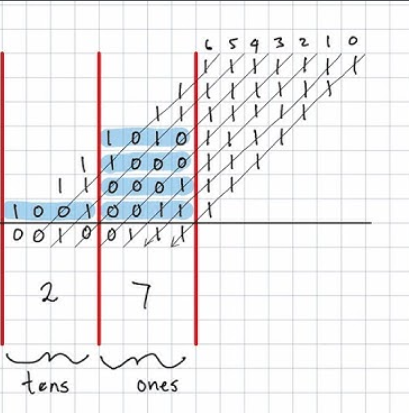
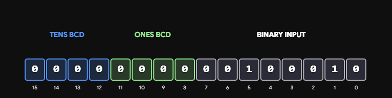
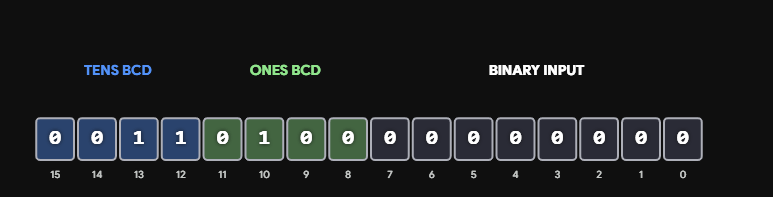
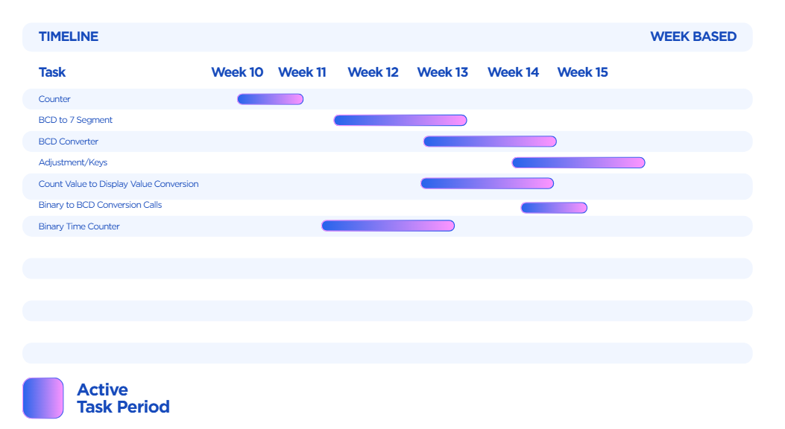

# 24-Hour Digital Clock (DE2-115 FPGA, Verilog)

A 24-hour clock written in Verilog and running on a **Terasic DE2-115** FPGA board (Intel Cyclone IV E). It shows **HH:MM:SS** on six common-anode 7-segment displays. Four push buttons reset the clock and set the time.

Built for *UEEEC0054 Provide Gate Array solutions for complex electronics systems* (Advanced Diploma of Electronics and Communications Engineering, RMIT, 2026).

## Features

- Counts seconds, minutes and hours from the board's 50 MHz oscillator, rolling over 23:59:59 → 00:00:00.
- Uses **Verilog tasks** for the repeated work, as the brief required: one binary-to-BCD converter and one 7-segment decoder, each called for every digit.
- Button presses are edge-detected, so holding a button adds exactly one minute or hour, not millions.
- Kept within the $30 budget. The board was supplied by RMIT.

| Button | Function |
|---|---|
| `KEY0` (rightmost) | Reset to 00:00:00 |
| `KEY1` | Hold to adjust. The clock pauses |
| `KEY2` | While adjusting, each press adds a minute |
| `KEY3` (leftmost) | While adjusting, each press adds an hour |

## How it works

### 1. One-second timebase

`CLOCK_50` runs at 50 MHz. A 26-bit counter counts up to 49,999,999, which is exactly one second. Each time it gets there, the seconds register goes up by one. Seconds roll into minutes at 60, minutes into hours at 60, and hours back to 0 at 24.

The main loop checks things in a fixed order:

1. **Reset**: zero everything.
2. **Adjust mode**: pause timekeeping and apply minute/hour button pulses.
3. **Normal**: tick.

### 2. Button edge detection

The DE2-115 keys are active-low, so they're inverted first. Each button then passes through two registers clocked at 50 MHz (`key_d1`, `key_d2`). `pulse = key_d1 & ~key_d2` is high for exactly one clock cycle on the rising edge of a press.

### 3. Binary → BCD: the `bin_to_bcd` task (double dabble)

Each 8-bit time value is loaded into a 16-bit shift register and shifted left 8 times. Before each shift, any BCD column (ones in bits 11:8, tens in bits 15:12) that is 5 or more has 3 added to it. That forces the carry into the next decimal digit. After 8 shifts, the upper byte holds the two BCD digits.

| Worked example (27) | 35, before shifting | 35, after shifting |
|---|---|---|
|  |  |  |

### 4. BCD → 7-segment: the `seg_display` task

A `case` statement maps each 4-bit digit to its 7-segment pattern. The patterns are active-low for common-anode displays, so `0` lights a segment. The 42-bit `Display` output is split into six 7-bit fields:

| Display bits | Digit | Board display |
|---|---|---|
| `[6:0]` | seconds ones | HEX2 |
| `[13:7]` | seconds tens | HEX3 |
| `[20:14]` | minutes ones | HEX4 |
| `[27:21]` | minutes tens | HEX5 |
| `[34:28]` | hours ones | HEX6 |
| `[41:35]` | hours tens | HEX7 |

## Files

| File | Contents |
|---|---|
| [`Clock50New.v`](Clock50New.v) | The whole design: timebase, counters, button edge detection, and the `bin_to_bcd` and `seg_display` tasks |
| `Clock50New.qpf`, `Clock50New.qsf` | Quartus project for the Cyclone IV E `EP4CE115F29C7`, with all the DE2-115 pin assignments |
| `docs/` | BCD conversion diagrams and the project Gantt chart |

## Build it

1. Open `Clock50New.qpf` in Quartus II 13.0 SP1 or later.
2. Run **Processing → Start Compilation**.
3. Connect the DE2-115 with the USB-Blaster and program it with **Tools → Programmer**.

## Planning

## What I learned

- Building an accurate timebase by dividing a 50 MHz clock in hardware.
- Using Verilog tasks to avoid repeating code, and implementing the double dabble algorithm.
- Handling active-low inputs and outputs on a real board.
- Why raw push buttons need edge detection at 50 MHz, and building it with a two-register synchroniser.
- Splitting a design into clear stages (timebase → counters → BCD → display) so it's easy to debug.
